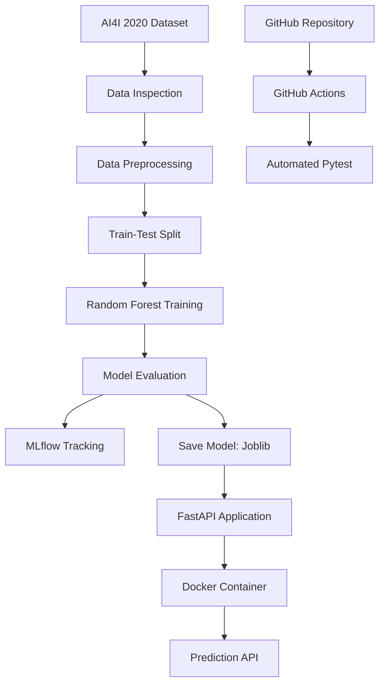

# AI-Powered Predictive Maintenance System with MLOps

An end-to-end machine learning and MLOps project that predicts industrial machine failures using sensor data. The system uses a Random Forest classifier, MLflow for experiment tracking, FastAPI for model serving, Docker for containerization, and GitHub Actions for continuous integration.

---

## Project Overview

Unexpected machine failures can cause production downtime, financial losses, and maintenance overhead.

This project uses machine sensor measurements to predict whether a machine is likely to experience a failure. It provides a REST API for real-time predictions and an automated testing pipeline for reliable deployment.

### Key Objectives

- Predict potential machine failures using sensor measurements.
- Build a reproducible machine learning training pipeline.
- Track experiments and model performance using MLflow.
- Deploy the trained model through FastAPI.
- Containerize the application using Docker.
- Automate testing with GitHub Actions.

---

## System Architecture



---

## Technology Stack

| Category | Technology |
|---|---|
| Programming Language | Python 3.11 |
| Data Processing | Pandas, NumPy |
| Machine Learning | Scikit-learn |
| Model | Random Forest Classifier |
| Experiment Tracking | MLflow |
| Model Serialization | Joblib |
| API Development | FastAPI |
| API Server | Uvicorn |
| Testing | Pytest, HTTPX |
| Containerization | Docker |
| CI/CD | GitHub Actions |
| Version Control | Git, GitHub |

---

## Dataset

**AI4I 2020 Predictive Maintenance Dataset**

Source: [UCI Machine Learning Repository](https://archive.ics.uci.edu/dataset/601/ai4i+2020+predictive+maintenance+dataset)

The dataset contains 10,000 records and 14 columns representing industrial machine sensor measurements and failure information.

### Dataset Information

| Property | Value |
|---|---|
| Total Records | 10,000 |
| Total Columns | 14 |
| Target Variable | Machine failure |
| Missing Values | 0 |
| Duplicate Records | 0 |
| Normal Records | 9,661 |
| Failure Records | 339 |

### Input Features

The following six features are used for prediction:

| Feature | Description |
|---|---|
| Type | Machine product quality type |
| Air temperature [K] | Air temperature |
| Process temperature [K] | Process temperature |
| Rotational speed [rpm] | Machine rotational speed |
| Torque [Nm] | Machine torque |
| Tool wear [min] | Tool wear duration |

**Target variable:** `Machine failure`

- `0` – No machine failure
- `1` – Machine failure

Identifiers and failure-mode columns are excluded from model inputs to prevent target leakage.

---

## Machine Learning Pipeline

### Algorithm: Random Forest Classifier

A Random Forest classifier is used to predict machine failures.

The preprocessing pipeline uses:

- OneHotEncoder for categorical machine types.
- Passthrough for numerical sensor measurements.
- Stratified train-test splitting to preserve class distribution.
- Balanced class weights to address the minority failure class.

### Model Configuration

| Parameter | Value |
|---|---|
| n_estimators | 200 |
| max_depth | 15 |
| min_samples_split | 5 |
| class_weight | balanced |
| random_state | 42 |
| n_jobs | -1 |
| Training Split | 80% |
| Testing Split | 20% |

### Model Evaluation

The model was evaluated on 2,000 held-out test records.

| Metric | Result |
|---|---:|
| Accuracy | 97.50% |
| Precision | 60.98% |
| Recall | 73.53% |
| F1-Score | 66.67% |
| ROC-AUC | 96.80% |
| PR-AUC | 74.90% |

### Confusion Matrix

| | Predicted Normal | Predicted Failure |
|---|---:|---:|
| Actual Normal | 1900 | 32 |
| Actual Failure | 18 | 50 |

**Observations:**

- The model correctly identified 50 out of 68 actual machine failures.
- It missed 18 actual failures.
- It incorrectly flagged 32 normal machines.
- Failure recall was approximately 73.53%.

The dataset is highly imbalanced, so accuracy alone is not sufficient to evaluate model performance. Precision, recall, F1-score and PR-AUC are also considered.

These results represent the initial model baseline. Further threshold tuning and validation can improve failure detection.

---

## MLflow Experiment Tracking

MLflow is used to track the model training experiment.

**Experiment name:** `predictive-maintenance`

**Run name:** `Random-Forest`

Tracked parameters include:

- Number of estimators
- Maximum tree depth
- Minimum samples split
- Class weight
- Random state
- Test split ratio

Tracked metrics include:

- Accuracy
- Precision
- Recall
- F1-score
- ROC-AUC
- PR-AUC

The trained pipeline is also logged as an MLflow model artifact.

### Start MLflow UI

```bash
mlflow ui --backend-store-uri sqlite:///mlflow.db --port 5000
```

Open:

http://127.0.0.1:5000

---

## FastAPI Deployment

The trained model is exposed through a REST API using FastAPI.

### Available Endpoints

| Method | Endpoint | Description |
|---|---|---|
| GET | `/` | API information |
| GET | `/health` | API and model health |
| POST | `/predict` | Predict machine failure |

### Example Prediction Request

**POST** `/predict`

```json
{
  "machine_type": "M",
  "air_temperature": 298.1,
  "process_temperature": 308.6,
  "rotational_speed": 1551,
  "torque": 42.8,
  "tool_wear": 108
}
```

### Example Response

```json
{
  "machine_failure": 0,
  "prediction": "No failure detected",
  "failure_probability": 0.12
}
```

*The response above is illustrative. Actual predictions and probabilities depend on the input data.*

### Run FastAPI Locally

```bash
uvicorn main:app --reload
```

Interactive API documentation:

http://127.0.0.1:8000/docs

---

## Docker Deployment

The application is containerized using Docker.

### Build Docker Image

```bash
docker build -t predictive-maintenance-api .
```

### Run Docker Container

```bash
docker run -d --name predictive-maintenance -p 8000:8000 predictive-maintenance-api
```

### Verify Container

```bash
docker ps
```

### Access Application

http://localhost:8000/docs

---

## Automated Testing

Pytest is used to validate the trained model and API endpoints.

### Test Coverage

**Model Tests**
- Model file existence.
- Model loading.
- Model prediction.
- Failure probability validation.

**API Tests**
- Home endpoint.
- Health endpoint.
- Prediction endpoint.
- Invalid input validation.

### Run Tests

```bash
pytest -v
```

### Test Results

**8 tests passed successfully.**

---

## GitHub Actions – Continuous Integration

GitHub Actions automates testing whenever code is pushed to the `main` branch or a pull request targets `main`.

### CI Workflow

1. Checkout repository.
2. Set up Python 3.11.
3. Install project dependencies.
4. Execute Pytest.
5. Report workflow status.

Workflow configuration:

`.github/workflows/ci.yml`

---

## Project Structure

```text
mlops-first-pipeline/
│
├── .github/
│   └── workflows/
│       └── ci.yml
│
├── data/
│   └── dataset.csv
│
├── models/
│   └── model.joblib
│
├── tests/
│   ├── test_model.py
│   └── test_api.py
│
├── train.py
├── main.py
├── inspect_data.py
├── requirements.txt
├── Dockerfile
├── .dockerignore
├── .gitignore
├── pytest.ini
├── README.md
└── mlflow.db
```

---

## Installation and Setup

### 1. Clone Repository

```bash
git clone https://github.com/earlykisses/predictive-maintenance-mlops.git

cd predictive-maintenance-mlops
```

### 2. Create Virtual Environment

```bash
python -m venv .venv
```

Activate on Windows:

```powershell
.venv\Scripts\Activate.ps1
```

### 3. Install Dependencies

```bash
python -m pip install --upgrade pip

pip install -r requirements.txt
```

### 4. Train Model

```bash
python train.py
```

The trained model is saved to:

```text
models/model.joblib
```

### 5. Start MLflow

```bash
mlflow ui --backend-store-uri sqlite:///mlflow.db --port 5000
```

### 6. Start FastAPI

```bash
uvicorn main:app --reload
```

### 7. Run Automated Tests

```bash
pytest -v
```

### 8. Build and Run Docker

```bash
docker build -t predictive-maintenance-api .

docker run -d --name predictive-maintenance -p 8000:8000 predictive-maintenance-api
```

---

## Future Improvements

- Hyperparameter tuning for Random Forest.
- Decision threshold optimization to improve failure recall.
- Model versioning and registration in MLflow.
- Data drift and model performance monitoring.
- Automated Docker image builds through GitHub Actions.
- Cloud deployment.
- Prediction history and monitoring dashboard.

---

## Author

**Piyush Kumar**

GitHub: [@earlykisses](https://github.com/earlykisses)

**Project Repository:** [Predictive Maintenance MLOps](https://github.com/earlykisses/predictive-maintenance-mlops)

---

## Dataset Citation

AI4I 2020 Predictive Maintenance Dataset.

UCI Machine Learning Repository.

DOI: https://doi.org/10.24432/C5HS5C

License: CC BY 4.0.

---

*Built as an end-to-end machine learning and MLOps project.*